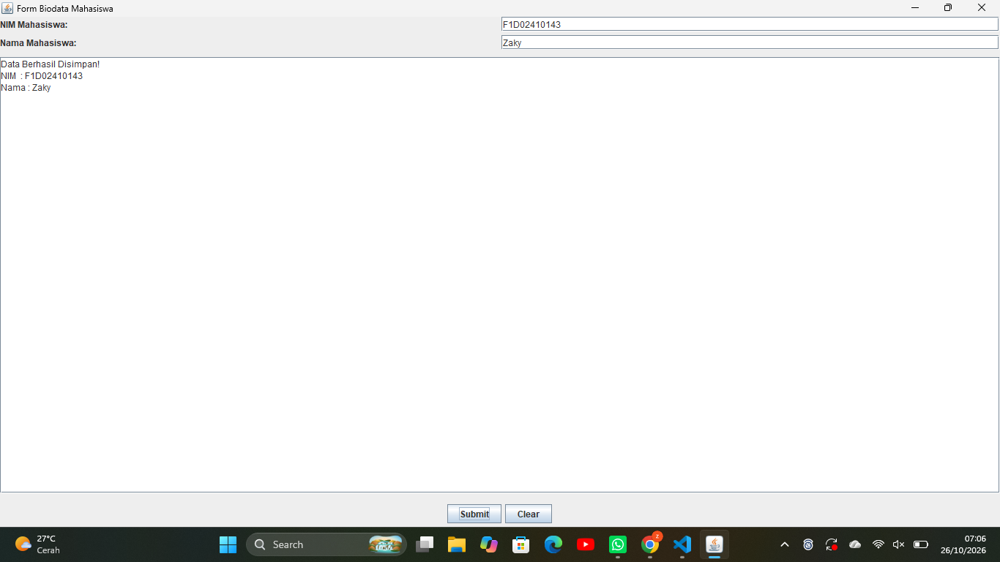

# Tugas PBO - Graphical User Interface (GUI)

*   **NIM:** F1D02410143
*   **Nama:** Zaky
*   **Link Repositori GitHub:** []

Repositori ini berisi tugas latihan Pemrograman Berorientasi Objek (PBO) mengenai pembuatan *Graphical User Interface* (GUI) menggunakan Java Swing. Aplikasi yang dibuat adalah "Form Biodata Mahasiswa Sederhana".

## Penjelasan Komponen GUI yang Digunakan

1.  **Top Level Container:** 
    Menggunakan kelas `JFrame` yang berfungsi sebagai jendela utama berdirinya seluruh program GUI.
2.  **Intermediate Component:** 
    Menggunakan kelas `JPanel` (`panelForm` dan `panelButton`). Berfungsi untuk mengelompokkan form teks dan tombol secara terpisah agar tata letaknya lebih rapi.
3.  **Atomic Component:** 
    Komponen spesifik untuk interaksi user, antara lain:
    *   `JLabel`: Memberikan label tulisan "NIM" dan "Nama".
    *   `JTextField`: Kolom input satu baris untuk mengetikkan data.
    *   `JButton`: Tombol aksi (Submit dan Clear).
    *   `JTextArea`: Area tampilan teks multi-baris untuk mencetak hasil *submit*.
4.  **Layout Manager:**
    *   `BorderLayout`: Diterapkan pada `JFrame` utama (menggunakan area `NORTH`, `CENTER`, dan `SOUTH`).
    *   `GridLayout`: Diterapkan pada `panelForm` untuk mensejajarkan Label dan TextField dalam pola matriks 2x2.
    *   `FlowLayout`: Diterapkan pada `panelButton` untuk menempatkan tombol bersebelahan secara rapi.
5.  **Event Handling (Menggunakan 2 Interface):**
    *   `ActionListener`: Menangani aksi dari klik tombol (memproses input ke text area saat tombol dklik, dan mengosongkannya jika tombol *clear* ditekan).
    *   `MouseListener`: Memberikan efek visual (hover) saat kursor mouse memasuki atau keluar dari area tombol (mengubah warna latar tombol).

## 📸 Screenshot Interface

