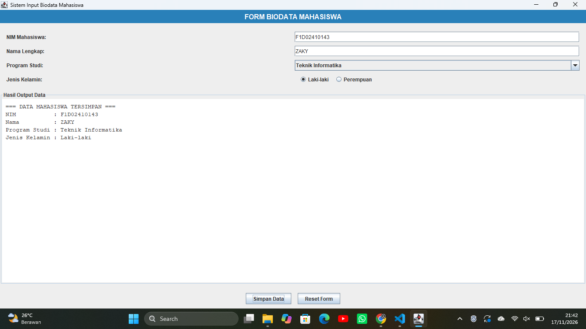

# TUGAS LATIHAN GUI

**Nama:** Zaky 
**NIM:** F1D02410143  
**Kelas:** C  

## Deskripsi Program
Aplikasi desktop sederhana berbasis Java Swing untuk menginput dan menampilkan biodata mahasiswa, dilengkapi dengan validasi input kosong serta interaksi *event handling*.

## 5 Komponen Utama GUI yang Digunakan

1. **Top-level Container Class**
   * `JFrame`: Digunakan sebagai jendela utama aplikasi (`FormBiodata extends JFrame`) yang menampung seluruh komponen antarmuka.

2. **Intermediate Container Class**
   * `JPanel`: Digunakan untuk mengelompokkan komponen berdasarkan fungsinya (`panelHeader`, `panelForm`, `panelGender`, `panelTengah`, `panelButton`).
   * `JScrollPane`: Membungkus `JTextArea` agar memiliki fitur gulir (*scrollbar*) otomatis ketika teks melebihi batas area tampilan.

3. **Atomic Component Class**
   * `JLabel`: Menampilkan teks keterangan statis pada judul dan setiap kolom input.
   * `JTextField`: Kolom input teks satu baris untuk mengisi NIM dan Nama Mahasiswa.
   * `JComboBox`: Menu *dropdown* untuk memilih Program Studi.
   * `JRadioButton` & `ButtonGroup`: Tombol pilihan tunggal untuk memilih Jenis Kelamin.
   * `JTextArea`: Area teks multi-baris untuk menampilkan ringkasan biodata yang telah disubmit.
   * `JButton`: Tombol interaktif untuk mengeksekusi penyimpanan (`Simpan Data`) dan pembersihan formulir (`Reset Form`).

4. **Layout Classes**
   * `BorderLayout`: Mengatur tata letak utama `JFrame` menjadi bagian atas (`NORTH`), tengah (`CENTER`), dan bawah (`SOUTH`).
   * `GridLayout`: Menyusun label dan kolom input pada `panelForm` secara rapi dalam format matriks baris dan kolom (4x2).
   * `FlowLayout`: Mengatur aliran posisi komponen secara horizontal pada `panelHeader`, `panelGender`, dan `panelButton`.

5. **Event Listener (Interface & Adapter Class)**
   * `ActionListener` *(Interface)*: Meng-override method `actionPerformed()` untuk menangani aksi klik pada tombol Simpan dan Reset.
   * `MouseListener` *(Interface)*: Meng-override method `mouseEntered()` dan `mouseExited()` untuk memberikan efek perubahan warna (*hover*) saat kursor menyentuh tombol.
   * `KeyAdapter` *(Adapter Class)*: Meng-override method `keyTyped()` pada kolom NIM agar setiap huruf yang diketik otomatis berubah menjadi huruf kapital (*uppercase*).

## Screenshot Hasil
